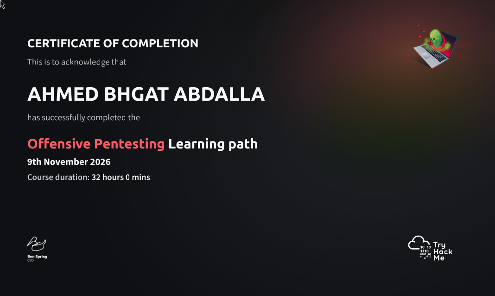

# 🛡️ CyberSecurity & CTF Write-ups

Welcome to my personal collection of CTF & lab write-ups for **HackTheBox** and **TryHackMe**. 

This repository documents my practical journey in penetration testing, vulnerability research, and privilege escalation techniques.

> *"The quieter you become, the more you are able to hear."* 💻🔓

---

## 📂 Repository Structure

Browse the folders above to explore the walkthroughs and methodologies:

* 📁 **[HackTheBox](./HackTheBox)** – Full machine walkthroughs, enumeration, and exploitation steps.
* 📁 **[TryHackMe](./TryHackMe)** – Lab solutions, security challenges, and hands-on notes.

---

### ⚠️ Disclaimer
All write-ups and techniques documented in this repository are strictly for **educational purposes** and authorized security testing only.

## 🏆 Completed Learning Paths
**TryHackMe: Offensive Pentesting** (32 Hours)

